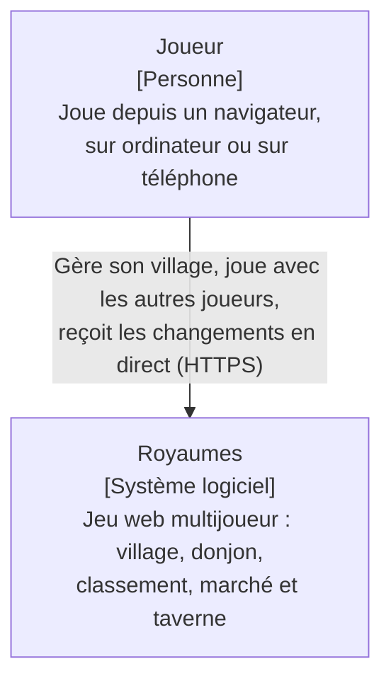
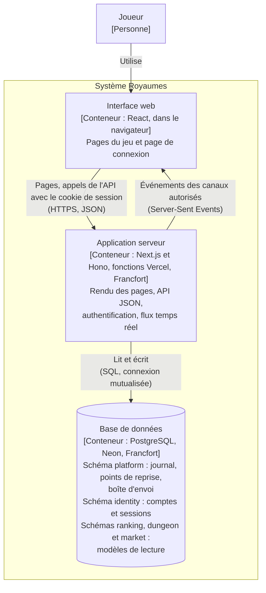
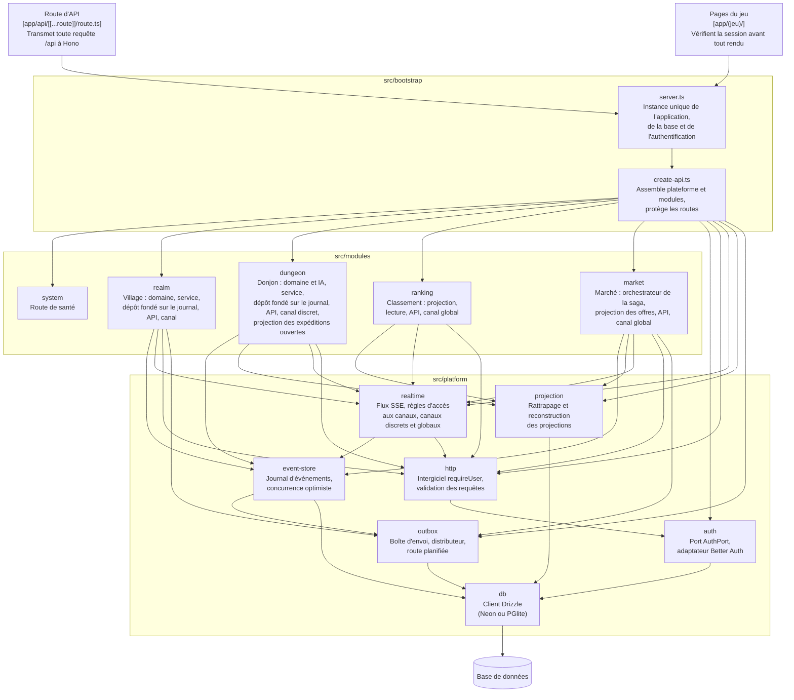
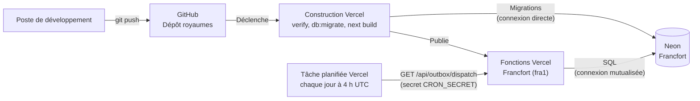

# Architecture de Royaumes

Ce document décrit la structure du système selon le modèle C4, du plus général au plus
détaillé. Les raisons des choix qui y apparaissent sont consignées dans les
[décisions d'architecture](adr/README.md).

Les diagrammes sont rédigés en Mermaid : ils sont versionnés avec le code, et mis à jour
dans le même commit que la modification qu'ils décrivent.

## Niveau 1 - Contexte

Royaumes ne dépend d'aucun système externe : il n'envoie aucun courrier électronique et
ne fait appel à aucun service de paiement ni à aucun fournisseur d'identité. Les comptes
des joueurs sont gérés par le système lui-même.

## Niveau 2 - Conteneurs

| Conteneur | Technologies | Responsabilités |
| --- | --- | --- |
| Interface web | React, composants des modules (`ui.tsx`) | Affichage des vues, envoi des actions du joueur, abonnement aux canaux temps réel |
| Application serveur | Next.js, Hono, Better Auth, Drizzle | Contrôle d'accès, règles du jeu, enregistrement des événements, diffusion des flux |
| Base de données | PostgreSQL (Neon en production, PGlite en local et en test) | Conservation du journal d'événements, des comptes et des sessions ; modèles de lecture des modules |

Le journal d'événements est la seule source de vérité. Les tables des schémas `ranking`,
`dungeon` et `market` sont des modèles de lecture, dérivés du journal par des projections : elles peuvent
être vidées puis reconstruites à tout moment, sans perte d'information.

L'interface web ne communique jamais directement avec la base : toute lecture et toute
écriture passent par l'application serveur, qui applique le contrôle d'accès.

## Niveau 3 - Composants de l'application serveur

Une flèche signifie « dépend de ». Le diagramme ne montre que les dépendances principales :
`server.ts` crée également lui-même la base, le journal et l'adaptateur d'authentification,
qu'il transmet à `create-api.ts`. Les modules `dungeon` et `ranking` écrivent directement
dans leurs propres tables, au sein de la transaction fournie par le moteur des projections.

Le module `ranking` lit des événements du Village et du Donjon, mais n'importe aucun de leurs
fichiers en dehors de leurs contrats : il ne dépend que de leur langage publié, c'est-à-dire
du nom et des données de leurs événements, ainsi que du préfixe de leurs flux.

Le module `market` modifie les villages sans jamais importer le code du Village : il enregistre
des messages dans la boîte d'envoi, que le distributeur remet aux gestionnaires du Village.
La seule dépendance directe porte sur les contrats du Village (`REALM_TOPICS`, `ResourceAmounts`),
qui décrivent ces messages. Chaque transaction ne modifie que les données d'un seul module,
et la boîte d'envoi (ADR 0007).

Les règles suivantes sont vérifiées automatiquement par
dependency-cruiser (`.dependency-cruiser.cjs`) à chaque exécution de `pnpm verify` :

- la plateforme ne dépend d'aucun module ;
- un module n'est accessible que par ses entrées publiques (`index.ts`, `contracts.ts`, `ui.tsx`) ;
- le domaine d'un module ne dépend d'aucune bibliothèque technique ;
- la couche application d'un module ne dépend pas de sa couche infrastructure ;
- le code destiné au navigateur ne dépend d'aucun code serveur ;
- aucune dépendance circulaire n'est admise.

Seule la racine de composition connaît à la fois la plateforme et l'ensemble des modules.

## Niveau 4 - Code

Ce niveau n'est pas dessiné : il est décrit par le code lui-même et par ses tests, que
tout diagramme maintenu à la main ne tarderait pas à contredire.

## Déploiement

Chaque envoi sur la branche `main` déclenche un déploiement. Le code n'est publié que si
l'ensemble des contrôles a réussi, et les migrations ne sont appliquées qu'après ces contrôles.

La tâche planifiée, déclarée dans `vercel.json`, distribue chaque jour les messages restés en
attente dans la boîte d'envoi. Elle ne s'exécute que sur le déploiement de production.